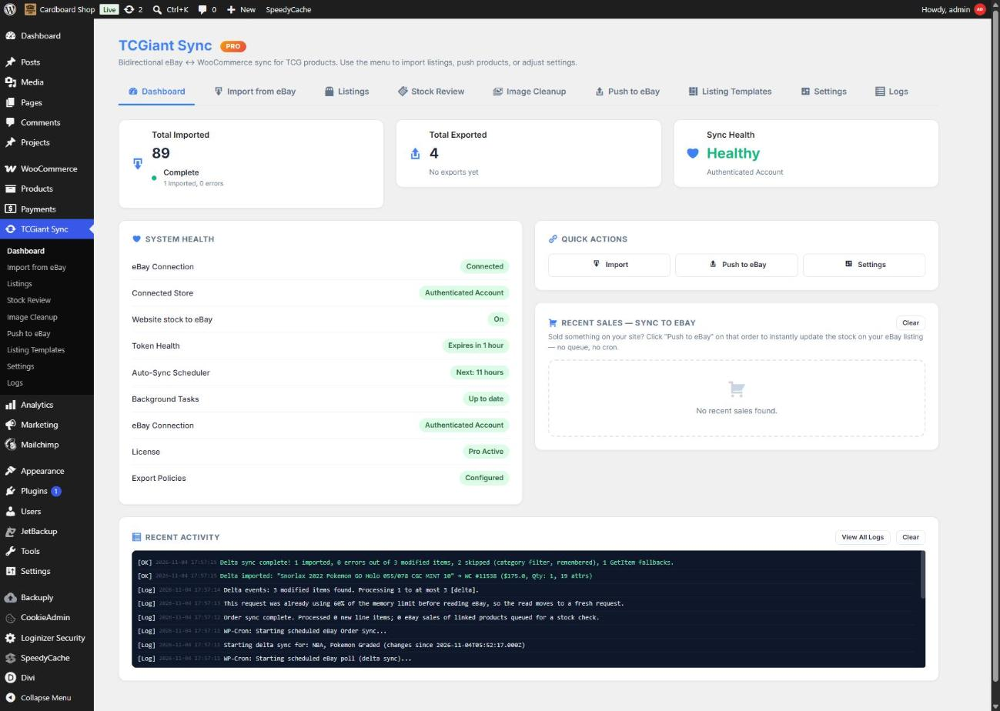
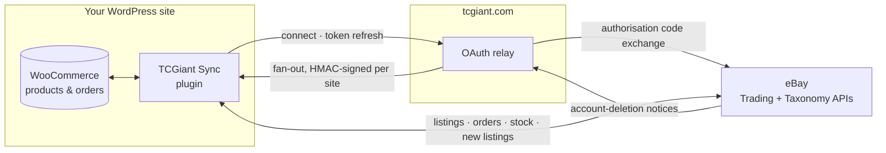
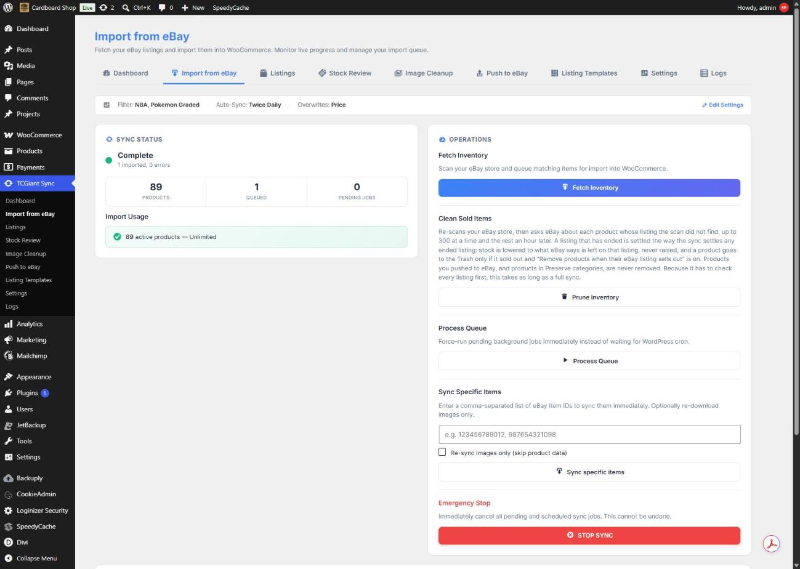
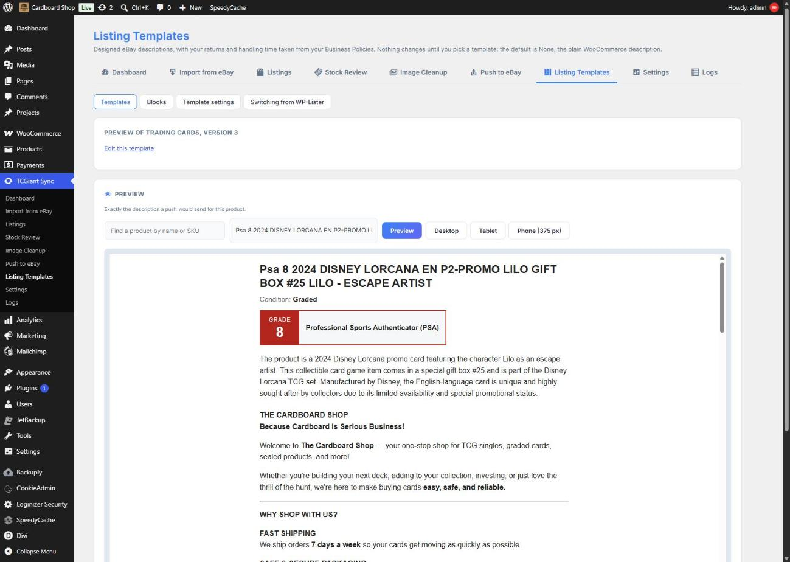

  

# TCGiant Sync

**Two-way eBay ↔ WooCommerce sync that keeps one catalogue honest across both — built for card and coin sellers, and works for anyone.**

  

---

## What is TCGiant Sync?

A WordPress plugin that connects a WooCommerce shop to an eBay seller account and keeps the two in step, in both directions:

- **Import** your eBay listings into WooCommerce — titles, descriptions, images, item specifics, weight and size, categories — and keep them current on a schedule.
- **Push** WooCommerce products to eBay as live listings, with eBay's own category tree, business policies, and condition vocabulary — including the graded/ungraded descriptors that trading-card and coin categories require.
- **Design the eBay description** with listing templates, and **price for eBay** separately from your website, per product or by a rule.
- **Reconcile stock** whichever side sells: a sale on eBay reduces WooCommerce; a sale on your site updates eBay; a listing that ends without selling settles the quantity rather than zeroing it.

It grew up serving trading-card and coin shops, and that shows in what it knows: PSA, BGS, CGC and SGC grading, eBay's Graded/Ungraded condition IDs, coin condition ladders. But the machinery underneath is general — an **"All Other"** item type lists electronics, parts, clothing or anything else with plain conditions and no grading.

## Why TCGiant Sync?

Selling the same stock in two places means keeping two catalogues in agreement, and by hand that never lasts. The specific ways it fails are the ones this plugin is built around:

- **Overselling.** An item sells on eBay at 2 a.m. and is still for sale on your site at 9. Or a listing *ends without selling* and a naive sync zeroes the stock you still hold. Both directions are handled, and ended-unsold is treated differently from sold-out.
- **Drift you don't see.** A scheduled delta sync only asks eBay what changed in the last 48 hours; a site that was unreachable for a day never hears about a listing that ended in that window. A weekly full scan walks the whole account so nothing stays stale for long.
- **eBay's vocabulary.** Category IDs, condition IDs that mean different things in different categories, required item specifics, business policies. The plugin speaks it so you don't have to — and tells you *before* contacting eBay when a required field is empty.
- **Units and marketplaces.** A listing on eBay UK is metric and a listing on eBay US is not. The plugin reads the measurement system from each listing itself, so a 0.6 kg part stays 0.6 kg.
- **Nothing to run.** No cron server, no middleware, no bring-your-own eBay developer keys. Connect once with eBay's OAuth and the plugin does the rest on WordPress's own scheduler.

## Features

Names in **bold** are the names the plugin's own screens use.

### Import — eBay → WooCommerce

| | |
|---|---|
| Import active listings, with images localised to your media library. Photos you pushed to eBay are known when they come back, so they are never downloaded again | ✅ |
| Automatic product mapping: attributes from item specifics, categories, variations | ✅ |
| Variations on your global attributes (**Products → Attributes**) keep their values at every sync; **Add eBay's new variation values to global attributes?** (No by default) adds a value eBay sells that the attribute lacks | ✅ |
| **Import listings from**: every eBay site, or only your **Primary eBay Marketplace** — for sellers whose listings are copied to other eBay sites | ✅ |
| **eBay Custom Store Categories to Import** and **eBay Standard Categories to Import** filters. The plugin remembers each listing's categories, so a changed listing outside your categories is skipped without an eBay call | ✅ |
| **Import eBay auctions** (off for new shops). A product on a running auction shows its bid, links to the auction and cannot be bought on your website | ✅ |
| Scheduled delta sync (**Auto-Sync Interval**: every 15 minutes, hourly — the default — twice daily or daily) plus a weekly full sync | ✅ |
| **Inventory pruning** after a full sync that reads all your listings cleanly: stock is only ever lowered to match eBay, and nothing changes if more than 20% of linked products would need checking | ✅ |
| Ended-listing detection every hour, with **ended-unsold ≠ sold-out** stock handling | ✅ |
| Weight and dimensions, in the right units for the listing's marketplace | ✅ |
| **Data Mapping (Re-imports)**: which side wins for title, description, price, images, categories and tags, attributes, weight and dimensions | ✅ |
| Bake eBay shipping cost into the product price | ✅ |
| Map eBay SKU to a Bin Location field | ✅ |
| **Remove products when their eBay listing sells out?**, with **Preserve Categories (Do Not Trash)**. Products you pushed to eBay yourself are never removed | ✅ |
| **Import eBay orders into WooCommerce?** — at every **Auto-Sync Interval** (hourly by default, every 15 minutes at the shortest); an unpaid order arrives as Pending payment and follows eBay for 30 days (paid, cancelled, cancel requested); tracking numbers go back to eBay when an order is marked Completed | ✅ |

### Push — WooCommerce → eBay

| | |
|---|---|
| Unified **eBay Listing** tab on every product: Item Type → eBay Category → Condition → Listing Options → Item Specifics → Push to eBay | ✅ |
| Single push, bulk push from the Products list or the **Listings** screen, and background processing via Action Scheduler | ✅ |
| **Verify**: tests the listing with eBay without creating it, and shows the estimated fees | ✅ |
| Smart update detection — revises an existing listing rather than creating a duplicate; **Link to this listing** joins a product to a listing you made on eBay | ✅ |
| An Update of a listing imported from eBay keeps eBay's own category, condition, business policies, location and handling time. Tick **Send my shop defaults** on a product to send yours instead | ✅ |
| Category auto-suggestion from the product title, plus an interactive category browser | ✅ |
| **eBay Motors Parts & Accessories** categories, for shops on eBay United States | ✅ |
| **Item Specifics** section: which item specifics the category requires, the value that would be sent, and what is missing | ✅ |
| Condition descriptors for Trading Cards and Coins (Graded with grader/grade/cert, or Ungraded) | ✅ |
| **UPC, EAN or ISBN** on new listings, from the product's eBay tab or WooCommerce's own GTIN field. Where a category requires one and the product has none, **Products With No UPC, EAN or ISBN** sends eBay's own "Does not apply", or refuses the push | ✅ |
| **"All Other"** item type for non-collectibles, with eBay's plain condition list | ✅ |
| Package weight and dimensions, converted to the listing site's system (optional) | ✅ |
| Per-product listing type (Fixed Price / Auction), duration, shipping policy, category, condition | ✅ |
| Business Policies (shipping, returns, payment) fetched with **Fetch / Refresh Policies from eBay** | ✅ |
| **Best Offer** and **GPSR** (EU product safety) defaults from Settings, sent to the products that use your defaults | ✅ |
| **Send website stock changes to eBay?** — a website sale, refund, cancellation or stock edit updates the eBay listing, which is read first so eBay is never sent more than it shows | ✅ |
| **Auto-relist ended listings?** — up to 50 a day, only listings that still have stock; a listing you ended in TCGiant Sync or in Seller Hub stays ended. A fixed-price relist, automatic or by hand, goes up at the price a push would send when you changed the price here, and any relist goes up with the product's photos when you changed them here | ✅ |
| A new listing never goes up without its main photo | ✅ |

### eBay listing templates

| | |
|---|---|
| **Listing Templates** screen: design the eBay description around your product's own, with a header, condition and grading, item specifics, returns and handling time, and a link to your eBay Store | ✅ |
| Five starters, installed as drafts: **Clean**, **Trading cards**, **Coins**, **Sealed or general** and **Dark** — or start blank, import a template file, or convert a WP-Lister template | ✅ |
| A design form (colours, logo, banner, which parts show) and an HTML and CSS editor with placeholders: `{{title}}`, `{{{description}}}`, `{{#x}}…{{/x}}` | ✅ |
| **Preview**: exactly what a push would send for any product, at **Desktop**, **Tablet** and **Phone (375 px)** widths, with warnings and what was removed. **Check with eBay** asks eBay to check it without creating a listing | ✅ |
| Choose a template as your **Default template**, **By WooCommerce category**, or on a product's eBay tab; a bulk action on the Products list sets many at once | ✅ |
| eBay's content rules applied before sending: scripts, forms, frames, links that leave eBay and pictures not served over https are removed. The editor warns about email addresses, phone numbers, social media handles and web addresses that aren't eBay's | ✅ |
| Phone-friendly: the starters have no fixed width over 700 px and read at 375 px; the preview warns about wider fixed widths | ✅ |
| Every save keeps a version (the last ten), with Restore; templates export and import as files | ✅ |

Nothing changes until you choose a template: the default is **None**, the plain WooCommerce description.

### Pricing on eBay

| | |
|---|---|
| A separate **eBay price** for each product, and for each variation of a variable product. Your website keeps its own price | ✅ |
| An **eBay Price** rule for products without their own: the regular price plus a percentage, a fixed amount or both, with optional rounding up to .99 or to a whole number | ✅ |
| **eBay Prices Include Tax** (No, Auto or Yes) for shops on eBay UK, Germany, France, Italy, Spain and Australia whose prices are entered without tax; Auto in a new install | ✅ |
| With **Overwrite Price** on, an import never writes a marked-up eBay price into your website price | ✅ |

### Listings, Stock Review and Image Cleanup

| | |
|---|---|
| **Listings** screen with **Active**, **Ended** and **Sold** views, and how each listing ended | ✅ |
| **Origin** column and filter: whether each listing was imported from eBay or pushed from here, and what its Updates send | ✅ |
| Bulk actions: Push to eBay, End Listing, Relist, Change listing format, and **Send my shop defaults to eBay on Update** / **Keep each listing's own eBay values on Update** | ✅ |
| **Stock Review**: products that sold out on eBay but are still here, stock changes eBay never took, products that may be the same item twice, and products imported from other eBay sites | ✅ |
| **Image Cleanup**: photos left behind by deleted products, old 1,536 px copies of downloaded photos, and copies downloaded over your own photographs; **Products to look at** lists products whose photos need a check by hand | ✅ |

### Safety

| | |
|---|---|
| Checked before anything reaches eBay: card listings outside eBay's three single-card categories, coin parent categories, whole vehicles, business policies eBay keeps for motor vehicles only, prices under 0.99 and descriptions over 500,000 characters | ✅ |
| Staging and development copies of your shop send nothing to eBay, and still read from it. A copy at any address other than the one your shop was at when you connected eBay waits until an administrator presses **This is my live shop** | ✅ |
| Respects the daily eBay call allowance all TCGiant shops share: past 80% of it, hand edits and imports wait until just after midnight UTC; bulk pushes are limited to 2,000 products a day by default | ✅ |
| Keeps your site to its own daily share of eBay calls: once it is used, syncs, scans, look-ups and relists wait until 00:00 UTC, while sales still reach eBay | ✅ |
| **Emergency Stop** cancels the sync's pending jobs; **Resume Import** carries a stopped full sync on from where it stopped | ✅ |

### Everywhere

- **OAuth 2.0** through a hosted relay — you never handle eBay developer credentials, and the plugin never stores them.
- **Live dashboard** with connection health, sync status, and an activity log that says what happened and why.
- **Connection test** that distinguishes "our host is refusing you" from "your network intercepts everything" — the difference between a rule your host can lift and one they can't.
- **Marketplaces:** US, UK, Canada, Australia, Germany, France, Italy, Spain.

### Free and Pro

The free tier imports up to 50 active products; **Pro** removes the cap and adds priority support. Push to eBay is not limited in either. → [tcgiant.com/pro](https://tcgiant.com/pro/)

## Demo

**Website and Pro:** https://tcgiant.com/pro/

A recorded walkthrough of a full import and a push is on the roadmap; the screenshots below are from a live shop.

## How It Works

The relay exists for one reason: eBay's OAuth requires an application secret, and that secret must never sit inside a plugin distributed to thousands of sites. So the relay holds it, performs the code exchange and token refresh, and hands each site its own signing key. **Everything else — every listing fetched, every product pushed, every stock update — goes directly from your site to eBay** with your site's own token.

**What runs when**

| Trigger | What happens |
|---|---|
| You press *Fetch Inventory* | Full sync of the eBay account, 200 listings per page, carrying on across as many requests as a large store needs. *Resume Import* carries on one that stopped; *Emergency Stop* cancels it |
| Every sync interval (*Auto-Sync Interval*, hourly by default) | Delta: eBay is asked what changed since the last run; changed listings are re-mapped, new ones imported (within the free cap), sold-out ones removed if you've asked |
| Every sync interval, with the delta | eBay orders imported into WooCommerce, if *Import eBay orders into WooCommerce?* is on |
| Every hour | Ended-listing check: stock settled from the listing's *listed − sold*, so an unsold end keeps your goods in stock |
| Daily, 3 AM | *Auto-Relist*, if on: up to 50 ended listings that still have stock |
| Weekly | Full sync, to catch anything a delta could not see. If it reads all your listings cleanly, *inventory pruning* follows once: products whose listing the sync did not see are checked with eBay, about 300 an hour, and stock is only ever lowered to match. The weekly full sync does not run while the *Auto-Sync Interval* is Disabled. Separately, *Check stock against eBay weekly?* compares stock and only reports |
| A stock change on your site | With *Send website stock changes to eBay?* on: the listing is read first, then sent your stock, never more than eBay already shows; ended at zero if *Auto-end listing when stock reaches 0?* is Yes |
| A push | Product validated locally (category, condition, policies, required item specifics, price) before eBay is contacted; then queued and listed in the background |

## Quick Start

### Requirements

WordPress 5.8+, PHP 7.4+, WooCommerce 5.0+, an eBay seller account. Push to eBay needs [Business Policies](https://bizpolicy.ebay.com) enabled on the seller account (most are).

### Steps

1. **Install** — download `tcgiant-sync-<version>.zip` from the [latest release](https://github.com/SurefireStudios/TCGiant-Sync/releases/latest), then *Plugins → Add New → Upload Plugin → Activate*.
2. **Connect** — *TCGiant Sync → Settings → Connect to eBay*, and approve in eBay's window. The setup wizard asks for your marketplace; if you skip it, the plugin takes the marketplace from your first imported listing.
3. **Import** — *TCGiant Sync → Import from eBay → Fetch Inventory*. Optionally narrow it first under *Settings → Import Filters*: which eBay site and which categories to import. The *Auto-Sync Interval* (hourly unless you change it) keeps it current after that.
4. **Push** — in *Settings → Push to eBay Settings*, set a default category and press *Fetch / Refresh Policies from eBay*. Then open any product → *eBay Listing* tab → Item Type → Category → Condition → **Push**. The checklist tells you what's missing before eBay does.
5. **Optional: a listing template** — *TCGiant Sync → Listing Templates*, start from one of the five starters, preview it on a few products, set it to Published and make it the default. Each listing gets it at its next push.
6. **Optional: an eBay price** — set a rule in *Settings → Push to eBay Settings → eBay Price*, or an eBay price on a product's eBay tab.

Updates arrive through WordPress's normal update screen.

## Architecture

**Stack:** PHP 7.4+, WordPress, WooCommerce, Action Scheduler (background jobs), eBay Trading API (XML) for listings/orders/stock and eBay Taxonomy API (REST) for categories and aspects, WP-Cron for scheduling. The relay is a small PHP + SQLite service.

**Key classes** — all under `includes/`, autoloaded by name:

| Class | Role |
|---|---|
| `TCGiant_Sync_OAuth` | Connect, token refresh via the relay, the connection test |
| `TCGiant_Sync_API` | Trading + Taxonomy calls, retry, rate limiting, the daily call budget |
| `TCGiant_Sync_Importer` | Full and delta scans, page walking, pruning, the free-tier gate |
| `TCGiant_Sync_Mapper` | eBay item → WooCommerce product: attributes, variations, units, images |
| `TCGiant_Sync_Exporter` | WooCommerce product → eBay listing XML, condition descriptors, package details |
| `TCGiant_Sync_Inventory` | Stock in both directions; the ended-listing settlement rule |
| `TCGiant_Sync_Catalog` | The eBay vocabulary the screens show: categories, conditions, graders, grades |
| `TCGiant_Sync_Listing_Link` | Keeps a product's eBay link honest when products are duplicated |
| `TCGiant_Sync_Entitlements` | "May another product be imported?" — the licence extends it |
| `TCGiant_Sync_Cron` | Scheduling and the background-dispatch plumbing |
| `TCGiant_Sync_Image_Localizer` | Background image download, with a guard against re-importing a shop's own photos |
| `TCGiant_Sync_Jobs` | The bulk-job runner behind bulk push, verify, settle and cleanup |
| `TCGiant_Sync_Webhooks` | eBay account-deletion endpoint, verified against the per-site signing key |

**A design rule worth knowing:** the source tree *is* the Pro edition. Lite (WordPress.org) and Standard (WooCommerce.com) editions are being built from this same tree by leaving files out, never by forking it — so every fix lands once. The classes above are shaped by that: what every edition needs lives in files every edition ships.

**Safety nets in the repo** — `tools/`:

- `check-hooks.php` records every hook registration and fails if one goes missing. A lost stock-sync hook produces no error; stock just stops flowing. This is the only thing that would notice.
- `check-formats.php` runs every translatable format string through `sprintf`, because a stray backslash in one once took a site down.
- `check-archive-parity.php` confirms that what auto-updating sites receive and what the uploaded zip contains are the same files.
- `check-version.php`, `check-views.php`, `check-tabs.php`, `check-limit-gates.php` — see [`tools/README.md`](tools/README.md).

## Screenshots

| | |
|---|---|
|  |  |
| Dashboard: connection health, sync status, activity | Import: category filters, usage, live progress |
|  | |
| Listing Templates: the preview of exactly what a push would send | |

## Use Cases

- **A card shop that lives on eBay** and wants its website to mirror the eBay inventory without retyping anything — imports, then scheduled syncs keep it honest.
- **A shop that lives on WooCommerce** and wants its catalogue on eBay too — push, with eBay's categories suggested from titles and required specifics named before you submit.
- **Graded stock.** PSA 10s, CGC 9.8s, slabbed coins — the condition descriptors eBay requires for those categories, from a dropdown rather than a spec sheet.
- **Not cards at all.** Networking gear, car parts, clothing: the *All Other* item type, plain conditions, package weight for calculated postage. Shops on eBay United States can list into eBay Motors Parts & Accessories categories.
- **Outside the US.** UK, EU and Australian sellers get metric in and metric out, and push to the right eBay site in the right currency. A seller whose listings are copied to other eBay sites can import only the listings on their own site.
- **A designed eBay description.** A listing template around each product's description, with your logo, its condition and grading, item specifics and your return terms, previewed at phone width before anything is sent.
- **A different price on eBay.** A markup rule for the whole catalogue, or an eBay price on a single product or variation, while the website keeps its own prices.
- **Moving from WP-Lister for eBay.** Import links your existing listings, and your WP-Lister listing templates can be converted into TCGiant drafts.

## Roadmap

Tracked as [issues labelled `roadmap`](https://github.com/SurefireStudios/TCGiant-Sync/issues?q=is%3Aissue+is%3Aopen+label%3Aroadmap). Headlines:

- **Editions.** Lite on WordPress.org and Standard on WooCommerce.com, built from this tree. Stage 1 (the extractions) shipped in 3.14.1; Stage 2 (splitting the scheduler and stock-push halves out) is next.
- **Per-product condition** with eBay's per-category condition list, including refurbished and for-parts.
- **Brand and MPN** fields on pushed listings (UPC, EAN and ISBN shipped in 3.30.3).
- **Lossless weight round-trips** by storing kilograms and pounds to four decimals.

## Contributing

Bug reports and pull requests are welcome — see [CONTRIBUTING.md](CONTRIBUTING.md) for the development setup, the checks every change must pass, and the release process. Please read [SECURITY.md](SECURITY.md) before reporting anything that could affect a merchant's account.

## License

[GPL-2.0-or-later](LICENSE). eBay and WooCommerce are trademarks of their respective owners; this project is not affiliated with either.
